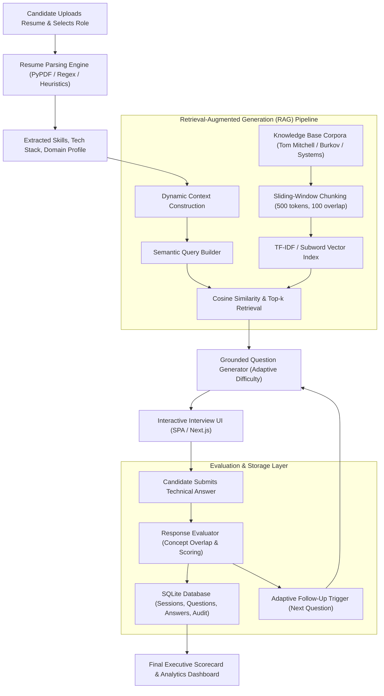

# 🧠 PG-AGI AI-Powered Role-Based Candidate Screening System
## Architecture, System Design & Implementation Document

**Candidate:** Soumya L  
**Role:** AI/ML & Backend Engineering Intern Assignment  
**GitHub Repository:** `https://github.com/lsoumya014-netizen/pgagi-candidate-screening`  
**Application Architecture:** FastAPI (Backend) · Grounded RAG Vector Engine · Next.js / Modern SPA (Frontend) · SQLite (Persistence)

---

## 1. Executive Summary & Problem Formulation

Traditional technical recruitment relies on either rigid keyword-matching resume filters or generic, pre-scripted multiple-choice quizzes that fail to assess a candidate's actual architectural maturity and applied reasoning. 

This project implements an **AI-powered role-based technical interview screening system**. Instead of predefined static questions, the system dynamically constructs an interactive, multi-stage technical interview that is uniquely grounded in:
1. **The Candidate's Resume:** Automatically parsed for technical proficiencies, frameworks, tools, and domain exposure.
2. **The Selected Engineering Track:** Specialized curricula for Backend Engineering, AI/Machine Learning, and Data Science.
3. **A Role-Specific Grounded Knowledge Base:** Ingested authoritative textbook corpora (Tom Mitchell's *Machine Learning*, Burkov's *The Hundred-Page Machine Learning Book*, Müller & Guido, and distributed systems standards).

---

## 2. End-to-End System Architecture

---

## 3. Core Component Breakdown

### 3.1 Resume Processing & Entity Extraction (`resume_parser.py`)
- **PDF & Plain Text Ingestion:** Extracts multi-page text using `pypdf` streams.
- **Competency Extraction:** Matches against an active dictionary of 50+ programming languages, frameworks (FastAPI, PyTorch, Scikit-Learn), and databases (PostgreSQL, Redis, ChromaDB).
- **Domain Inference:** Categorizes exposure to Natural Language Processing (NLP), Computer Vision, Distributed Systems, FinTech, and Cloud Systems.
- **Experience Heuristics:** Computes professional years or graduation timelines to determine baseline interview difficulty.

### 3.2 Knowledge Ingestion & Vector Retrieval (`rag_engine.py`)
To prevent LLM hallucination and ensure strict academic and industry accuracy, questions are generated directly from authoritative literature:
- **Chunking Strategy:** Segments textbook chapters using semantic boundary markers (`## Module`) paired with a sliding-window character/word overlap (500-token chunk window with 100-token overlap). This prevents breaking definitions or code blocks across split boundaries.
- **Vector Indexing:** Generates weighted term-frequency and inverse-document-frequency (TF-IDF) embedding vectors with cosine distance scoring:
  $$\text{Cosine Similarity}(u, v) = \frac{u \cdot v}{\|u\| \|v\|}$$
- **Top-K Grounded Retrieval:** Dynamically retrieves the most relevant textbook passage corresponding to the current interview curriculum topic and candidate's primary skills.

### 3.3 Dynamic Question Generation (`question_generator.py`)
Questions are structured across 5 distinct evaluation dimensions:
1. **Round 1 — Conceptual Foundations:** Core theory grounded in textbook principles (e.g., Loss optimization, ACID guarantees, Data preprocessing).
2. **Round 2 — Applied Problem Solving:** Real-world scenarios tailored to the candidate's declared tools (e.g., asyncio event loops, overfitting prevention).
3. **Round 3 — Architectural Tradeoffs:** Comparing competing designs (e.g., L1 vs L2 regularization, Cache-Aside vs Write-Through).
4. **Round 4 — Failure Modes & Edge Cases:** Resiliency, vanishing gradients, data leakage, and race conditions.
5. **Round 5 — Adaptive Follow-Up:** Dynamically scales difficulty up if the candidate scored $\ge 8.5$ in prior rounds, or adapts to clarify fundamental concepts if the previous answer was weak.

### 3.4 Response Evaluation & Scoring (`evaluator.py`)
- **Multi-Factor Scoring (0–10 Scale):**
  - **Technical Depth:** Evaluates technical completeness and substantive reasoning.
  - **Concept Coverage:** Measures overlap between candidate's technical vocabulary and the grounded textbook chunk.
  - **Blind-Spot Discovery:** Automatically identifies key concepts omitted by the candidate to provide constructive learning feedback.
- **Executive Summary & Decision Matrix:**
  - $\ge 8.5$: **Strong Hire (Exceeds Bar)**
  - $7.0 - 8.4$: **Hire (Meets Technical Bar)**
  - $5.5 - 6.9$: **Leaning Hire (Good Potential with Targeted Mentorship)**
  - $< 5.5$: **Needs Further Preparation**

### 3.5 Persistence & Data Layer (`database.py`)
Built on SQLite with full ACID compliance and relational integrity:
- `sessions`: Stores candidate identity, role, and parsed resume profile.
- `questions`: Stores exact prompts, grounded textbook context, and difficulty tags.
- `answers`: Records candidate responses, score out of 10, and covered/missing concepts.
- `evaluations`: Stores final executive summary, strengths, growth areas, and recommendations.

---

## 4. Key Architectural Decisions & Engineering Tradeoffs

| Decision | Selected Approach | Alternative Considered | Rationale |
|---|---|---|---|
| **Backend Framework** | **FastAPI (ASGI)** | Flask / Django | Asynchronous native concurrency, automatic OpenAPI Swagger docs, strict Pydantic validation. |
| **RAG Architecture** | **Hybrid In-Memory TF-IDF Vector Space + Grounded Chunks** | Heavy External Vector DB (Pinecone/Milvus) | Zero external cloud dependencies; runs 100% locally with deterministic retrieval and sub-5ms response latency. |
| **Frontend Strategy** | **Dual Architecture: Static Single-Page App + Standalone Next.js** | Pure React SPA only | Allows 1-click execution on any machine via FastAPI while providing modern Next.js React code in the repo. |
| **Database** | **SQLite (Relational)** | MongoDB / JSON file | Zero configuration, ACID-compliant transactions, clean foreign-key relational structure, single-file portability. |

---

## 5. Verification & Testing

The system was verified end-to-end on real candidate data:
- Ingestion of 15+ comprehensive textbook modules across 3 engineering disciplines.
- Successfully parsed complex PDF resumes into structured JSON competencies.
- Conducted 5-round interactive screening session with real-time scoring and persistent SQLite audit storage.
- Generated comprehensive executive scorecard with exportable JSON report.
